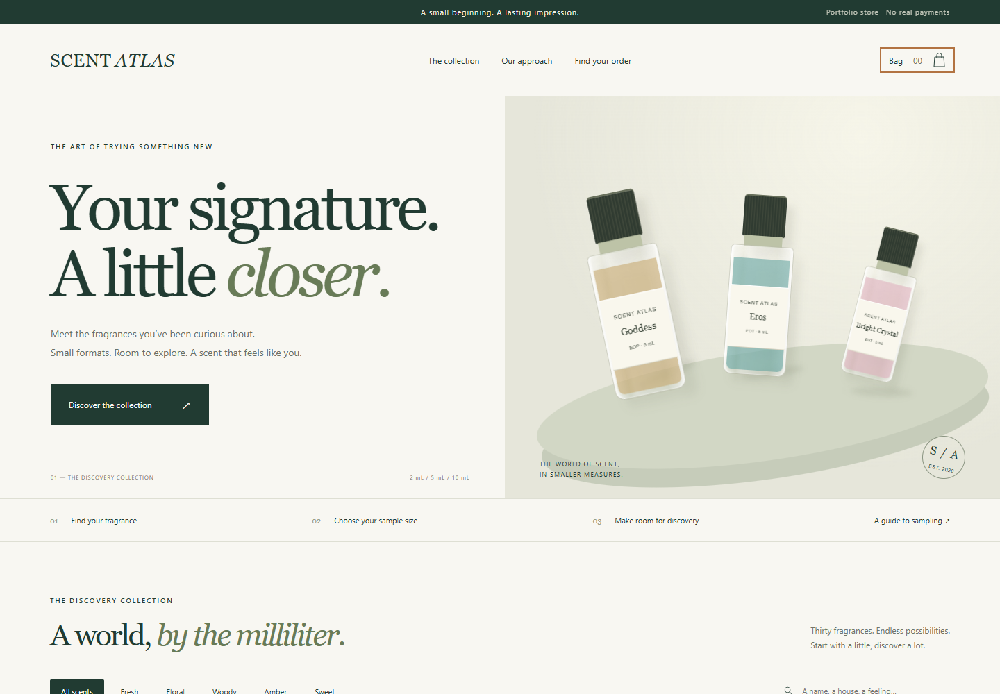

# Scent Atlas

**A fragrance discovery storefront for small-format samples.**

A full-stack portfolio project built with **Next.js, React, TypeScript, and Node.js**. Browse 30 fragrances, filter by an editorial scent family, choose a 2/5/10 mL format, build a persistent shopping bag, and place a server-priced demo order with receipt lookup.



[Mobile preview](docs/mobile.png) · [Catalog provenance](docs/catalog-sources.md) · [Verification notes](docs/verification.md)

## Features

- Search by fragrance or house, filter by scent family, and sort by name or sample price.
- Product details with sample size selection and consistent integer-cent pricing.
- Shopping bag persisted in browser storage, with quantity changes and removal.
- Server-side product, size, quantity, duplicate-line, and request validation. Submitted prices are ignored.
- Demo orders saved to local server storage using serialized, atomic writes, with opaque UUID references and order lookup.
- Native modal dialogs, keyboard dismissal, focus restoration, responsive layouts, and reduced-motion support.
- Original CSS decant illustrations; no retailer product photography or private store assets.

## Run locally

Requires **Node.js 22.18+** and npm.

```bash
npm ci
npm run dev
```

Open http://127.0.0.1:3000. No API keys or external database accounts are required.

```bash
npm test
npm run typecheck
npm run build
npm start
```

## How it works

```text
Browser                         Next.js / Node.js
Catalog + search + size choice   Shared product catalog and pricing
Persistent bag (localStorage) -> POST /api/orders -> Validate + calculate -> .data/orders.json
Order reference              -> GET /api/orders?id=<UUID> -> Receipt / demo status
```

`lib/catalog.json` holds the 30 product records. `lib/commerce.ts` is shared, deterministic pricing logic; the server independently recomputes all amounts. `app/api/orders/route.ts` creates and retrieves demo orders. `lib/orders.ts` owns file storage and write serialization. `app/page.tsx` implements the storefront.

### Storage and hosting

This version targets a **single Node.js process with writable persistent disk**, not an ephemeral serverless filesystem. Data is stored under `.data/` (ignored by Git); `ORDER_DATA_DIR` selects a different storage directory. It retains at most the latest 500 demo orders. Restarting the same instance preserves orders when its disk is retained; another instance or a cleared disk does not.

Before a multi-instance or production deployment, replace the file adapter with a database, add rate limiting, authentication/authorization, inventory reservations, transactional checkout, payment integration, and operational monitoring. The app collects no shipping address, payment information, or email. Order references grant access to non-personal demo receipt contents; there is no customer account system in this version.

## Catalog and demonstration scope

The collection is inspired by FragranceNet's best-selling collection pages, reviewed October 17, 2026. It is **not a verified top-30 sales ranking**. See [catalog sources](docs/catalog-sources.md) for provenance and editorial choices.

All prices, decant packaging, delivery costs, and orders are illustrative. No real payment, shipment, brand affiliation, official sample availability, or inventory is represented. The checkout does not call payment or email services.

This is a clean portfolio reimplementation of a previous storefront concept. It contains no prior private repository history, customer records, personal payment codes, or original commercial assets. No deployment or real sales are claimed.

## Checks

Unit tests cover tampered client prices, sample multipliers, invalid bags, unknown products, invalid quantities, duplicate lines, and delivery calculation. Production build and UI/API smoke checks are recorded in [verification notes](docs/verification.md).
